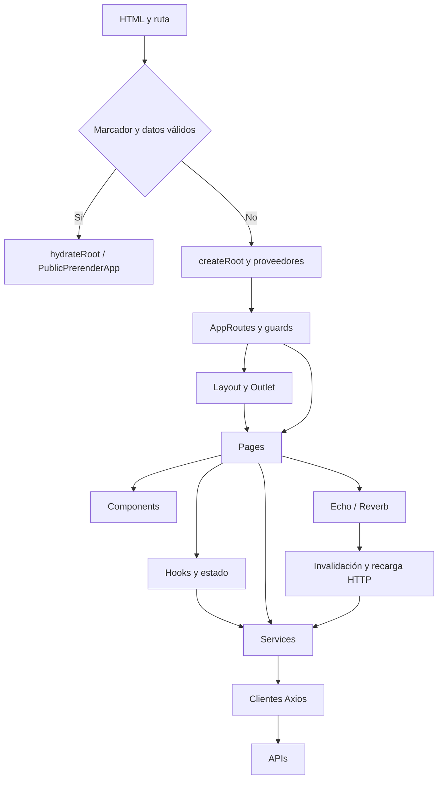

# Arquitectura

[Volver al índice](../README.md)

## Arranque

[main.jsx](../src/main.jsx) comprueba que el marcador data-public-prerender corresponde a la ruta. Para el blog valida el JSON inicial. Cuando corresponde ejecuta hydrateRoot con PublicPrerenderApp y caché Emotion; si no, createRoot con la aplicación general.

El árbol general es StrictMode → HelmetProvider → ThemeProvider → CssBaseline + BrowserRouter → AuthProvider → StaffAuthProvider → SystemAdminAuthProvider → App. [App](../src/App.jsx) monta el interceptor de respuestas y AppRoutes. [PublicPrerenderApp](../src/seo/PublicPrerenderApp.jsx) tiene su propia composición; no debe suponerse que monta todos los proveedores privados.

## Responsabilidades

| Capa | Responsabilidad | Consideración |
| --- | --- | --- |
| routes | Paths, parámetros, layouts y guards | No contiene toda la autorización operativa. |
| layouts | Sidebars, navegación y Outlet | Operación y caja consultan features del plan. |
| pages | Carga y coordinación de acciones y UI | Hay hooks y helpers junto a páginas. |
| components | Formularios, tablas, tarjetas, diálogos y editores | Algunos importan servicios directamente. |
| hooks | Catálogo, carrito, sesión QR, conjuntos y acceso | Componen servicios y estado React. |
| services | HTTP, payloads, respuestas y orquestación | NetPay coordina también operaciones nativas. |
| context | Sesión y acciones por audiencia | Tres estados y clientes separados. |
| realtime | Echo y autorización privada | Usa staff_token para autorizar. |
| utils | Normalización y errores | Diferenciar sesión, validación y negocio. |

La organización es por dominio; el menú y carrito comparten UI entre cliente público, mesero y caja. No se declaran Redux ni bibliotecas de caché de consultas. Se usan hooks nativos, contextos y un almacén específico de navegación de conjuntos con useSyncExternalStore.

## Layouts

- [RestaurantAdminLayout](../src/layouts/RestaurantAdminLayout.jsx): datos, ajustes, sucursales y canales del restaurante.
- [RestaurantOperationLayout](../src/layouts/RestaurantOperationLayout.jsx): operación del propietario y restricciones por plan.
- [CashierLayout](../src/layouts/CashierLayout.jsx): navegación de caja, features de clientes/pedidos en línea y coordinación de cierre de caja.
- [SystemAdminLayout](../src/layouts/SystemAdminLayout.jsx): navegación de plataforma.

## Dependencias

Rangos declarados: React/React DOM ^19.2.0, Router ^7.12.0, MUI ^7.3.9, Emotion 11, Axios ^1.13.2, Echo ^2.3.1, Pusher JS ^8.4.3, React Hook Form ^7.71.1, Helmet Async ^3.0.0, PayPal React SDK ^10.0.0 y React QR Code ^2.2.0. Vite ^7.2.4, ESLint 9 y Tailwind/PostCSS intervienen en construcción y desarrollo. sanitize-html participa en el prerender editorial.

Son rangos de package.json. Las resoluciones exactas corresponden al lockfile. Ver [inventario por archivo](inventario-modulos.md).

PublicPageNavigation observa la salida de la ruta prerenderizada y usa window.location.replace con pathname, search y hash. Así vuelve a cargar el documento correspondiente al pasar a otra superficie; la navegación desde esta rama no equivale siempre a una transición SPA sin recarga.
