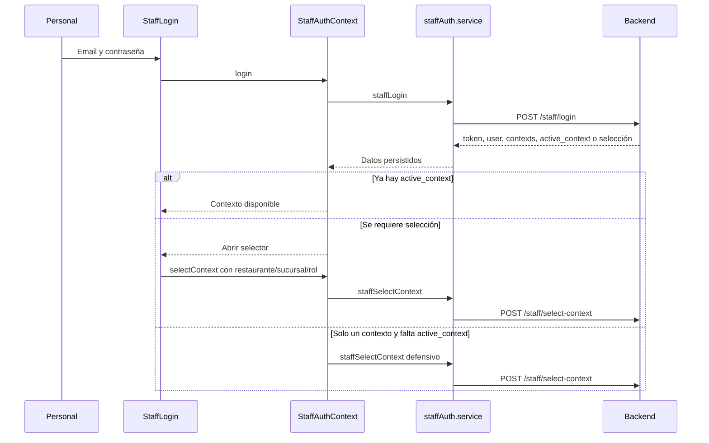

# Autenticación y permisos

[Volver al índice](../README.md)

## Tres sesiones independientes

| Audiencia | Contexto | Persistencia | Comprobación de ruta |
| --- | --- | --- | --- |
| Propietario/usuario | AuthContext | localStorage auth_token; sessionStorage auth_user_id y datos de retorno | ProtectedRoute requiere user autenticado; OwnerRoute también comprueba rol. |
| Personal | StaffAuthContext | localStorage staff_token; sessionStorage staff_user, staff_contexts y staff_active_context | StaffProtectedRoute comprueba existencia del token mediante el contexto. |
| Administrador del sistema | SystemAdminAuthContext | localStorage system_admin_token; sessionStorage system_admin_user | SystemAdminProtectedRoute espera carga y comprueba admin/system. |

Fuentes: [contextos](inventario-modulos.md), [servicio staff](../src/services/staff/staffAuth.service.js), [servicio sistema](../src/services/system-admin/systemAdminAuth.service.js), [guards](rutas.md).

AuthProvider consulta me al montar y mantiene user, loading y referralDiscount. refreshMe vuelve a consultar; updateUser sincroniza identidad; clearAuth elimina token/identidad. El login informa userChanged comparando identificadores. El logout owner espera al servicio antes de terminar su limpieza en el contexto; no asumir la misma garantía finally que staff/sistema ante fallos de red.

SystemAdminAuthProvider restaura usuario y valida con me si existe token; ante fallo limpia el almacenamiento. StaffAuthProvider restaura datos desde sesión sin una consulta de validación universal al montar. refreshContext consulta /staff/context y normaliza work_session_id, restaurant, branch y role.

## Flujos de acceso

Registro owner usa request-code, verify-code y resend-code; hay aceptación de términos y recuperación mediante password/request-code y password/reset. Los nombres y verbos exactos están en [auth.service](../src/services/auth/auth.service.js) y el catálogo. No se infiere verificación por enlace, OAuth, MFA o refresh tokens: no se identificaron como flujo implementado en estas fuentes.

Salir del contexto no equivale a revocar la sesión: exitContext llama /staff/exit-context. exitSmart hace logout si hay uno o ningún contexto, y sale solo del contexto cuando hay varios. El logout staff limpia localmente en finally. La revocación real del token corresponde al backend.

## Guards y autorización

- ProtectedRoute protege /app y conserva pathname + search en state.from al dirigir a /auth/login.
- OwnerRoute exige user y que role.name sea propietario sin distinguir mayúsculas, o role_id sea 2. Si no, dirige a /app.
- StaffProtectedRoute no incorpora una comprobación universal de rol mesero/cocina/cajero ni exige activeContext en su propio cuerpo. Páginas y backend deben validar su contexto operativo.
- SystemAdminProtectedRoute exige role.name admin y role.scope system, ambos normalizados a minúsculas; de otro modo dirige a su login.

La ocultación de un botón, el guard del navegador o un flag del plan no sustituyen la autorización del servidor. Las reglas backend completas y el aislamiento por restaurante/sucursal no pueden auditarse desde este repositorio.

## Restricciones por plan

RestaurantOperationLayout consulta getPlanAccess y mapea secciones a features:

| Feature | Secciones restringidas |
| --- | --- |
| ingredient_modules | Ingredientes. |
| warehouse_modules | Almacenes. |
| purchase_modules | Compras. |
| modifier_modules | Modificadores. |
| report_modules | Reportes de ventas, utilidad e inventario. |
| customer_loyalty_modules | Configuración de lealtad. |
| public_menu_advanced_customization | Personalización avanzada del menú público. |
| online_orders | Pedidos en línea. |

El layout retiene Outlet mientras carga una restricción y redirige a staff cuando una respuesta de acceso confirma que falta la feature. Si la carga falla, ese estado no equivale a una denegación backend confirmada; ver la condición shouldHoldOutlet en su fuente.

CashierLayout restringe pedidos en línea con online_orders y clientes con customer_loyalty_modules. usePlanAccess expone additional_sales_channels para consumidores de canales. Existen además reglas puntuales de UI y autorizadores operativos/de descuentos: no se puede construir una matriz universal de permisos solo a partir del router.

## Tokens públicos y caducidad

Menú, seguimiento y factura usan tokens de recurso en URL. El menú de mesa envía también device_identifier, generado y persistido con la clave public_device_identifier_v1. No es el Bearer owner/staff. El backend determina vigencia, asociación y permisos; no se documenta una duración universal de estos tokens.

El interceptor owner/staff conserva el destino de retorno y evita tratar todos los 403/409 como sesión inválida. No se identificó un mecanismo de renovación automática de token. Deben confirmarse expiración, política multidispositivo y revocación con el backend.
