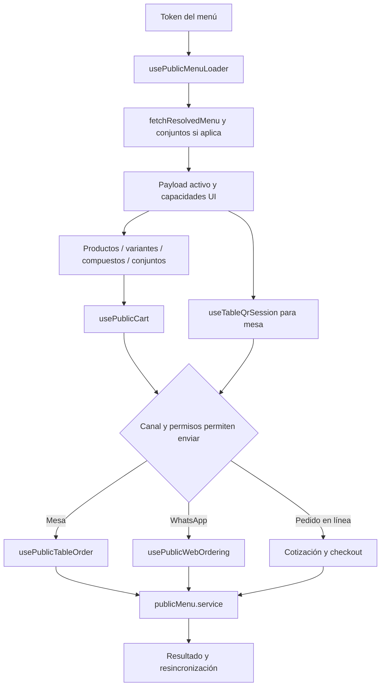

# Estados, flujos y tiempo real

[Volver al índice](../README.md) · [Referencia de suscripciones](referencia-realtime.md)

## Estado de la aplicación

Los contextos contienen identidad y contexto de trabajo; los estados de pantallas y hooks conservan carga, errores, filtros, selecciones, diálogos y resultados de negocio. No se identificó un store universal del dominio ni una caché global de servidor declarada.

| Estado | Propietario principal | Persistencia |
| --- | --- | --- |
| Identidad owner/sistema | Contextos respectivos | Token y datos auxiliares según servicio. |
| Contexto staff | StaffAuthContext | Token local y usuario/contextos en sessionStorage. |
| Menú y catálogo de conjuntos | usePublicMenuLoader | Estado React, firmas y secuencia de solicitudes. |
| Sesión QR | useTableQrSession | Estado, refs y device identifier persistente. |
| Carrito nuevo | usePublicCart y hooks staff/caja | React y almacenamiento de navegación específico cuando se usa. |
| Pedido confirmado/pendiente | Hooks de orden | Respuestas HTTP y refresco por eventos/acciones. |
| Configuración de conjunto | useMenuSetBuilder y menuSetNavigationStore | Almacén externo específico, borradores y carrito por contexto. |
| Disponibilidad | Hooks de catálogo/preparados | Datos servidor e invalidación. |

[menuSetNavigationStore](../src/hooks/menu/menu-sets/menuSetNavigationStore.js) crea claves por canal y contexto, admite publico, mesero, caja, whatsapp, pedido_en_linea y vista_general, y usa prefijo menu-set-navigation:. Contiene Map de entradas/listeners y límite de 30 contextos. Valida rutas internas de retorno y copia datos serializables. No es un sistema general de pedidos offline.

## Menú y envío

useCartAndOrder distingue el flujo WhatsApp mediante qr_type web, sales_channel_code WHATSAPP y public_flow whatsapp; el pedido en línea requiere web, ONLINE_ORDER y online_order. El modo alternativo por defecto es catalog_only. El pedido de mesa considera customer_assisted, sesión activa, selección habilitada y restricciones de ocupación/disponibilidad.

La composición separa carrito, pedido confirmado, pedido pendiente, cancelación y mensajes temporales. Mantiene pendingCancellation en el coordinador para compartirlo entre consulta y cancelación sin dependencia circular. La UI bloquea agregados si el pedido está paying y considera pendientes pending/pending_approval. Respeta flags customer_ui, permisos de inicio/continuación y disponibilidad de partidas; estas condiciones no enumeran todos los estados backend posibles.

Los totales distinguen estimados de nuevas partidas y resumen confirmado del servidor; no asumir que cartTotal equivale siempre al total final cobrado. El cambio de disponibilidad puede invalidar partidas y bloquear envío hasta corregirlas.

Para conjuntos, el carrito se conserva antes de navegar, se guarda borrador cuando se edita una partida y se registra retorno. El contexto impide mezclar pedidos de canales diferentes.

## Coordinación operativa

Mesero: tablero/contexto → carga de menú y orden actual → configuración de partidas → servicio staffOrders → refresco. Las solicitudes de reingreso/cancelación siguen servicios y diálogos propios. Cocina: consulta KDS por contexto/almacén → acción de preparación → servicio → actualización del tablero. Caja: apertura de sesión → cola o pedido directo/en línea → detalle y cuentas → ajustes/descuentos/autorización según respuesta → pago → ticket/precuenta y, si corresponde, devolución posterior.

No existe aquí una máquina de estados única y exhaustiva del backend. Los estados se interpretan por dominio. El seguimiento público representa estados como pending_acceptance, accepted, preparing, ready, out_for_delivery, arrived_at_destination, completed y rejected en sus recursos/UI; no se deben convertir en una secuencia obligatoria para toda modalidad. Confirmar las transiciones permitidas con el backend.

## Reverb y canales

[echo.js](../src/realtime/echo.js) crea un singleton Laravel Echo con broadcaster reverb y Pusher JS, transportes ws/wss, puerto numérico, TLS por esquema y disableStats. Pusher.logToConsole está activado en la fuente revisada.

Los canales privados se autorizan con POST fetch a una URL fija de ClicMenu `/api/broadcasting/auth`, Bearer staff_token y body socket_id/channel_name. Esta ruta no depende de VITE_API_BASE_URL. No inferir que el singleton pueda autorizar canales owner o sistema con sus tokens.

| Consumidor | Canal | Evento |
| --- | --- | --- |
| Tablero mesero / menú staff | branch.${branchId}.tables, privado | .table.grid.updated |
| Cocina | branch.${branchId}.kitchen, privado | .kitchen.kds.updated |
| Cola y pantallas de pedidos en línea de caja | branch.${branchId}.cashier, privado | .cashier.queue.updated |
| Menú público, sesión | public.session.${publicSessionChannelId} | .public.session.updated |
| Menú público, pedido | public.order.${publicOrderChannelId} | .public.order.updated |
| Seguimiento público | public.online-order.${token} | .online-order.tracking.updated |
| Disponibilidad de menú | data.realtime.channel y channel_type | data.realtime.event, normalizado con punto inicial |

Las plantillas conservan identificadores del código; los valores efectivos dependen del contexto. La [referencia](referencia-realtime.md) contiene extractos por archivo y limpieza de listeners/canales.

useMenuAvailabilityRealtime admite public/private, debounce predeterminado de 350 ms y una cola de un evento pendiente, reemplazado por el más reciente. Serializa el callback para evitar recargas simultáneas y limpia timers/listeners/canal al desmontar. Informa errores por callback o consola. Recibir una invalidación no implica que el payload contenga todo el catálogo: el consumidor decide la recarga.

## Polling y recuperación

Hay polling además de WebSocket: tablero de mesas y KDS usan intervalos de 10 s; la cola de caja también 10 s, bajo sus condiciones locales. useTableQrSession consulta solicitudes de reingreso cada 1500 ms, actualiza su reloj cada 1000 ms y envía heartbeat cada 30000 ms cuando aplica. Las pantallas de pedidos en línea y seguimiento tienen sus propios timers.

No se afirma que todos los timers corran siempre ni que todas las pantallas tengan recuperación idéntica. El loader público no contiene polling periódico del catálogo: su resincronización principal se coordina desde la página. Comprobar permisos, conexión, retorno a primer plano y limpieza de suscripciones al mantener estos flujos.

El almacén de navegación de conjuntos conserva entradas en memoria del módulo mediante Map y notifica a React con useSyncExternalStore; su fuente no utiliza localStorage ni sessionStorage. Permite conservar selecciones durante navegación dentro de la aplicación, pero no garantiza supervivencia tras recargar el documento. El seguimiento público define SILENT_REFRESH_MS en 7000 ms.
