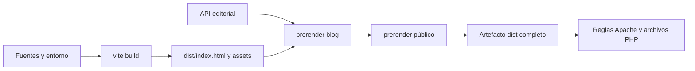

# Estilos, SEO y despliegue

[Volver al índice](../README.md)

## Sistema visual

[theme.js](../src/theme/theme.js) define el tema general MUI: primario naranja #FF9800, secundarios, estados semánticos, tipografía Roboto/Arial, shape y overrides de botones, campos, tarjetas, drawers, tablas, mensajes y menús. customLayout concentra ancho máximo 1100 y espaciados por breakpoint. PageContainer utiliza la infraestructura compartida de páginas.

[landingTheme.js](../src/theme/landingTheme.js) aporta la identidad pública: terracota #C95A3B, Poppins/Arial, colores y variantes tipográficas específicas, botones y contenedores. No asumir que cambiar el tema general modifica automáticamente todos los estilos de landing.

Coexisten sx de MUI, overrides de tema, CSS de landing/editorial y módulos de estilos del carrito. [index.css](../src/index.css) contiene directivas @tailwind; [PostCSS](../postcss.config.js) declara @tailwindcss/postcss y autoprefixer; [tailwind.config.js](../tailwind.config.js) enumera index.html y src como contenido. El hecho de declarar Tailwind no demuestra que toda la UI lo utilice ni valida por sí solo la compatibilidad de las directivas con la versión instalada.

[App.css](../src/App.css) existe, pero main.jsx importa index.css y App.jsx no importa App.css; no tratar sus reglas como estilos globales activos sin verificar imports. Los assets públicos se sirven desde public/images; src/assets contiene recursos importables. Revisar los imports en el [inventario](inventario-modulos.md) antes de cambiar una regla.

## SEO e hidratación

[SEO.jsx](../src/components/seo/SEO.jsx) administra title, description, keywords, canonical, Open Graph, robots y datos estructurados mediante Helmet. Tiene gestión compartida para retirar/restaurar etiquetas data-default-seo y soportar montajes consecutivos/StrictMode. El blog puede reemplazar metadatos por defecto.

[prerender-blog.mjs](../scripts/prerender-blog.mjs) carga entorno, consulta el blog clic-menu/blog-clicmenu bajo `/public/v1`, pagina publicaciones y obtiene detalles, categorías y etiquetas. Genera HTML dentro de dist/blog. Usa renderizado React en servidor, extracción de estilos Emotion, saneamiento de HTML editorial, datos JSON escapados e inspecciones de contenido/SEO. El contenido de artículos puede transformarse para conservar un único encabezado principal. El build depende de conectividad y datos editoriales válidos.

[prerender-public.mjs](../scripts/prerender-public.mjs) carga PublicPrerenderApp mediante Vite SSR y genera:

- dist/landing.html para portada.
- dist/contacto/index.html, dist/planes/index.html y dist/terminos-y-condiciones/index.html.
- Páginas de recursos menu-qr-con-canva y como-elegir-menu-qr bajo dist/recursos.

El script valida contenido esperado, H1, metadatos y estilos según cada página. Planes y términos conservan estados iniciales de carga en su HTML prerenderizado; no asumir que todo el contenido remoto queda resuelto durante SSR.

main.jsx reconoce rutas normalizadas sin barra final y marcadores de portada, contacto, planes, términos, blog, artículo y dos guías. Las categorías/etiquetas no figuran en su mapa de hidratación especial; pueden recibir metadatos generados y continuar mediante el arranque general. La presencia de un archivo HTML prerenderizado no implica que use la misma rama de hidratación que portada/artículo.

## Compilación

```sh
npm run build
```

La secuencia real es build:vite → prerender:blog → prerender:public. `npm run build:vite` solo produce la etapa Vite y no equivale al artefacto completo esperado por las reglas de hosting.

Vite configura base `/`, salida dist, emptyOutDir true y target chrome80. Habilita tratamiento JSX en src para extensiones indicadas y desactiva overlay HMR. No hay proxy backend declarado en vite.config.js.



Las variables de cliente quedan ligadas al build. Revisar canonical y URLs fijas para ambientes alternativos; VITE_PUBLIC_SITE_URL solo se consume donde lo declara el script editorial.

## Hosting observado

[public/.htaccess](../public/.htaccess) describe el despliegue Apache contemplado por el repositorio:

1. DirectoryIndex index.html.
2. Cabeceras para revalidar HTML y caché prolongada de assets con hash.
3. Redirecciones 301 de planes/contacto/términos/blog y guías hacia barra final.
4. Raíz servida internamente desde landing.html.
5. sitemap.xml reescrito a sitemap.php.
6. Resolución de rutas limpias hacia su index.html generado cuando existe.
7. Respeto de archivos/directorios físicos y fallback a index.html para SPA.

La copia de public forma parte de la salida estándar Vite, pero confirmar que el procedimiento de publicación preserve archivos ocultos como .htaccess. Un hosting que ignore Apache debe reproducir estas decisiones con su propio mecanismo; no hay configuración equivalente de Nginx, Netlify o Vercel establecida aquí.

[sitemap.php](../public/sitemap.php) consulta publicaciones del API editorial mediante cURL y genera sitemap con destinos fijos. Requiere PHP y cURL para ese recurso; no son necesarios para ejecutar la UI estática en navegador. [blog-meta.php](../public/blog-meta.php) también contiene lógica editorial/SEO y URLs fijas, pero el .htaccess revisado no lo invoca expresamente: confirmar su uso antes de declararlo parte activa del flujo productivo.

No se verificó una versión PHP, cuenta de cPanel, credenciales de despliegue, pipeline CI/CD, TLS del servidor o política de rollback. El comentario de vite.config.js menciona cPanel; no demuestra el proveedor realmente contratado.

## Procedimiento de publicación propuesto

Este procedimiento deriva de los artefactos y reglas existentes; requiere adaptarse al hosting confirmado.

1. Confirmar variables públicas, URLs fijas, API editorial y disponibilidad del backend/Reverb.
2. Ejecutar npm ci y las comprobaciones del equipo sobre una copia controlada.
3. Ejecutar npm run build; detener publicación ante fallo de cualquier prerender.
4. Revisar dist completo, incluidos landing.html, páginas editoriales, assets, imágenes, PHP y .htaccess.
5. Publicar el contenido de dist en la raíz prevista, conservando el artefacto anterior para restauración según el procedimiento del equipo.
6. Verificar portada, rutas con recarga directa, redirecciones, login, HTTP, canales privados, canonical, robots y sitemap.xml.

No se realizó esta publicación ni se comprobó el build en esta tarea de documentación.
